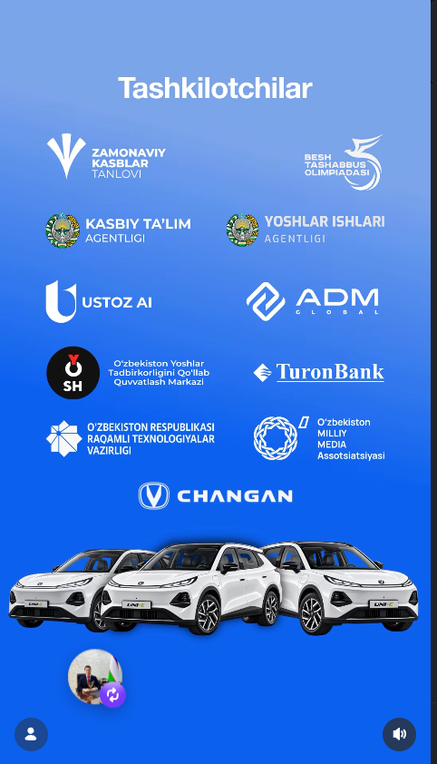

# Yuborilgan rasm va rasmiy video matni

> MAQOM: 2026-10-09 holatidagi tarixiy tadqiqot/tayyorgarlik qaydi. 13-oktabrga oid reja joriy sana, bosqich yoki natija deb olinmaydi. Hozirgi vazifa va reglament ustuvor. [Kontekst maqomi](https://azizbeksafarov.github.io/ustoz/CONTEXT-STATUS.md).

Qayd sanasi: 2026-10-09. Ushbu bo‘lim foydalanuvchi taqdim etgan materiallarni saqlaydi. Videoning og‘zaki matni foydalanuvchi yuborgan transkriptdan; mustaqil audio transkripsiyasi bajarilmagan.

## Video transkripti

Foydalanuvchi matnni Ustoz AI Instagram sahifasidagi rasmiy ko‘rsatma sifatida yuborgan. Veb-sayt yo‘nalishi videosi rasmiy Telegram kanalida ham topilgan: [Ustoz AI, 5-oktabr](https://t.me/ustozai/3357).

> Zamonaviy kasblar tanlovi va veb-sayt yasash yo‘nalishi bo‘yicha ishtirok etayotgan bo‘lsangiz, mana bu video aynan siz uchun. Tanlov o‘tkazilayotgan manzilda sizga kompyuter beriladi va kompyuterda esa antigraviti va kodeks ilovasi o‘rnatilgan bo‘ladi. 15 minut davomida siz o‘sha ilovalardan ro‘yxatdan o‘tib, o‘zingizni akkauntingizni ulaysiz. So‘ngra ekspertlarimiz sizga o‘zini mavzularini topshirishadi. Yasash davomida siz bemalol har xil saytlardan g‘oyalar yoki shablonlar olsangiz bo‘ladi. Ish jarayoni tugagandan so‘ng har bir ishtirokchi 15 minutdan o‘zini yasagan veb-saytini taqdimot qiladi va ekspertlar esa o‘sha taqdimotdan mezonlarga asosan baholashadi. Tanlovda hammaga omad, changan avtomobili sizniki bo‘lishi mumkin.

Mazmunidan olinadigan ma’lumot: tashkilotchi kompyuteri, Antigravity va Codex, akkaunt uchun 15 daqiqa, mavzu joyida, g‘oya/shablon olish mumkin, 15 daqiqa himoya. Videoda amaliy ishning aniq soati ushbu transkriptda aytilmagan.

## Tashkilotchilar posteri

Ko‘rinadigan yozuv va logotiplar:

- Zamonaviy kasblar tanlovi; Besh tashabbus olimpiadasi.
- Kasbiy ta’lim agentligi; Yoshlar ishlari agentligi.
- Ustoz AI; ADM Global.
- O‘zbekiston yoshlar tadbirkorligini qo‘llab-quvvatlash markazi; TuronBank.
- O‘zbekiston Respublikasi Raqamli texnologiyalar vazirligi.
- O‘zbekiston Milliy Media Assotsiatsiyasi.
- Changan; uch avtomobil tasviri.

Poster hamkorlar va tashkilotchilar logotiplarini ko‘rsatadi. Har bir logotipni qo‘shma qarorni imzolagan organ deb olish mumkin emas. Rasmning o‘zidan mashina komplektatsiyasi, narxi yoki har viloyat uchun alohida avtomobil borligini aniqlab bo‘lmaydi. Uni-E nomi Kasbiy ta’lim agentligining rasmiy e’lonidan olingan.

## Ishtirokchi bildirgan tashkiliy kontekst

Urgut vakili sifatida tuman bosqichida boshqa amaldagi qatnashuvchi bo‘lmagani sabab viloyatga to‘g‘ri yo‘llanma olingani aytilgan. Bosqich joyi Samarqand shahri, sana 2026-yil 13-oktabr deb bildirilgan. Bu ma’lumotlar ishtirokchi bergan; ochiq manbalardan bino, soat va bunday yo‘llanmaning alohida istisno bandi topilmagan.

Ishtirokchi qo‘shimcha ssenariyni muhokama qilgan: tashkilotchi shaxsiy akkauntga kirishni taqiqlab, barcha ishtirokchilar uchun maxsus akkaunt tayyorlashi mumkin. Bu tasdiqlangan tadbir tartibi emas, ehtimoliy shart. Ish rejasi ikkala holatga moslangan.
